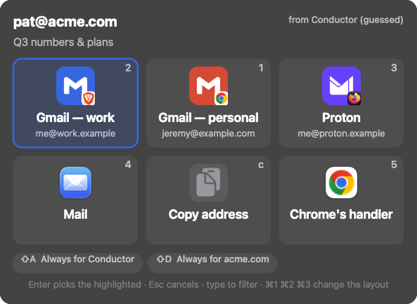
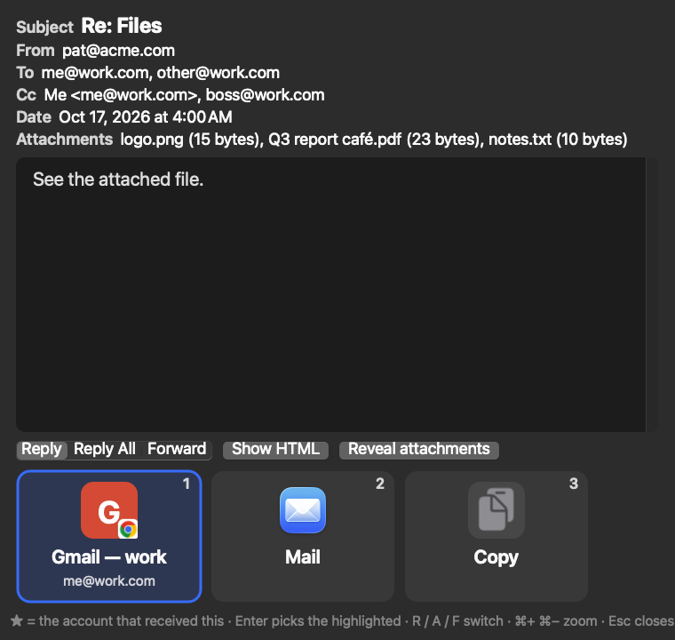

# Mailto Segue


**Every `mailto:` link, exactly where you want it.**

Mailto Segue is a small, open-source macOS app that becomes your default email app and then hands each email off to the right place:

- Gmail in **a specific account**, in **a specific browser and profile**
- a desktop mail app (Mail, Mimestream, Outlook, Spark, Thunderbird…)
- or just your clipboard

When you click an email link, a **chooser** pops up with a big button for each of your destinations: "Gmail — work", "Yahoo", "Mail". Each button has its own picture. Click one (or press its number) and it's gone. You can also let **rules** decide for you, e.g. "links clicked in Slack → work Gmail" or "anything to `acme.com` → work Gmail".

Double-click an **`.eml` file** and Mailto Segue shows the message with the same big buttons underneath: **Reply with Gmail — work**, **Reply with Yahoo**… Click one, the window closes, and the reply opens in that account with the original quoted. Segue marks the account that received the email with a ★. If that account is Gmail, Segue can jump straight to the real thread instead, so your reply stays threaded.

Got lots of addresses? Switch the chooser from **Large tiles** to **Small tiles** or a **Compact list**.

<p align="center">
  
</p>

### Mailto Segue doesn't hang around

Mailto Segue isn't a menu-bar app and doesn't run in the background. macOS launches it when you click a link or open an `.eml`, you pick a button, the draft opens elsewhere, and Mailto Segue quits. The whole thing is built to show the chooser in under 200 ms. (If you'd rather keep it resident, there's a setting for that.)

### What Mailto Segue is *not*

Mailto Segue is a **marshaller**, not a mail client. It never composes, edits or sends email, and it never asks for your mail password. It decides *where* a draft opens. You still type your message in Gmail, Yahoo, Mail.app, or wherever it lands.

> **Status:** the code for v1.0 is written (M0–M12) and unit-tested. The first release is waiting on
> the signing certificate and the real-browser checks in `docs/manual-test.md`. Nothing is published yet.

---

## Install (once v0.1 ships)

```sh
brew install --cask jeremym/tap/mailto-segue
open -a "Mailto Segue"
```

Then click **Make Mailto Segue default** (first launch asks you right away) and confirm the macOS prompt.

Mailto Segue is signed with the project's own certificate, not an Apple Developer ID, and is **not notarized** (see [below](#why-its-not-notarized)). The cask removes the quarantine flag on install, so there's no Gatekeeper prompt, and `brew upgrade` keeps it that way.

Other ways in:

- **From a clone:** `make install` builds Mailto Segue on your Mac (ad-hoc signed, never quarantined) and puts `Mailto Segue.app` in `~/Applications`. Needs Xcode or the Command Line Tools with Swift 6.
- **Release zip:** download it from GitHub Releases, move `Mailto Segue.app` to `~/Applications`, then open **System Settings → Privacy & Security → Open Anyway**, or run `xattr -dr com.apple.quarantine "$HOME/Applications/Mailto Segue.app"`.

Before `brew uninstall`, click **Restore Mail as default** in Mailto Segue (or run `segue restore-default`).

## Quick start (planned)

1. Open Mailto Segue. It asks to become your email app; macOS will ask you to confirm.
2. The first chooser already lists what Mailto Segue found on your Mac: Mail.app, every browser, and Gmail for each Google account signed into a Chrome, Brave, Edge or Vivaldi profile. Add, rename or re-picture any of them.
3. Click any `mailto:` link. Click a button or press its number. **Esc** cancels. Type to filter.
4. Want to skip the chooser next time? Toggle **Always for this app** or **Always for this domain** in the chooser. Hold **⌥** when clicking a link to get the chooser back.

## The `.eml` reader

<p align="center">
  
</p>

If the account that received the message is a Gmail destination, "Reply with" opens the **real thread** in Gmail (found by Message-ID), so your reply stays threaded and the attachments are right there. Any other destination gets a draft with the original quoted. Forward offers **Reveal attachments** so you can drag them into the compose window.

## The `segue` command

```sh
segue doctor                                   # check the setup and every destination
segue route "mailto:pat@acme.com?subject=Hi"   # route a link (rules, or the chooser)
segue open message.eml                         # open a message in the reader
segue make-default | restore-default           # the mailto: handler (macOS asks you to confirm)
segue pause-rules on|off                       # every link shows the chooser while paused
segue settings                                 # open the main window
```

It lives at `Mailto Segue.app/Contents/Helpers/segue`; the Homebrew cask links it into your PATH.

## Privacy

- No telemetry, no accounts, no passwords, no network calls. Mailto Segue only opens the URLs you asked for; your webmail sign-in stays in your browser.
- HTML email is shown with every remote image and script blocked, so tracking pixels never fire.
- Settings and history stay on your Mac in `~/Library/Application Support/Mailto Segue/`. The settings file is plain JSON you can edit by hand or keep in your dotfiles.
- History keeps full message text (compressed, never attachments). It's capped at 500 items or 50 MB, whichever comes first, which is usually under 10 MB in practice. You can clear it with one click or turn it off.
- No Accessibility, Automation or Full Disk Access permissions needed.

---

## How this project is run

### Releases are made by hand

There is no CI/CD. There's no build farm, no release bot, and no pipeline of 14 YAML files, because the whole engineering org is one guy and his Mac. He is both the build server and the on-call rotation. If other people ever join, CI gets added then.

A release looks like this:

```sh
make test
scripts/release.sh 1.2.3           # universal build, signed with "Segue Release", zip + sha256, git tag
gh release create v1.2.3 dist/MailtoSegue-1.2.3.zip dist/MailtoSegue-1.2.3.zip.sha256
scripts/update-tap.sh --tap ~/GitProjects/personal/homebrew-tap --version 1.2.3 --zip dist/MailtoSegue-1.2.3.zip
# then commit + push the tap by hand
```

### The Homebrew tap

Mailto Segue lives in [`jeremym/homebrew-tap`](https://github.com/jeremym/homebrew-tap) as **`Casks/mailto-segue.rb`**, next to the other casks in that tap.

- It's a cask in a personal tap, on purpose. `homebrew/cask` has refused apps that fail Gatekeeper since 2026-09-01, and `--no-quarantine` is gone, so the cask strips the quarantine flag itself in a postflight step (the same way AeroSpace and ClipySecure do).
- A fully-qualified name (`jeremym/tap/mailto-segue`) needs no `brew tap` and no trust flag.

### Branches

- `main` is always the latest.
- Work happens on short feature branches that merge straight into `main`.
- There's no `dev` branch. It's one person working fast.

### Signing

Release builds are signed with a long-lived, self-signed **"Segue Release"** certificate. Local and `make install` builds are ad-hoc signed (`codesign -s -`). Mailto Segue needs no special permissions, so neither loses anything.

#### Verifying a download

```sh
shasum -a 256 MailtoSegue-1.2.3.zip                 # matches the .sha256 on the release
codesign -d -r- "$HOME/Applications/Mailto Segue.app"  # certificate leaf = H"<hash published here once the cert exists>"
```

The leaf hash is the same for every release. If it ever changes, the release notes will say why.

#### Why it's not notarized

Notarization needs a paid Apple Developer ID. Mailto Segue is a personal project signed with its own certificate instead. Integrity rests on the published sha256 and the certificate leaf hash, not on Apple's notary service. If you'd rather trust nothing at all, build from source with `make install`.

---

## Tech

- Native Swift 6, AppKit for the chooser, SwiftUI for the main window, built with Swift Package Manager. No Xcode project.
- macOS 14 Sonoma or later. Universal binary (Apple silicon + Intel).
- The `mailto:` parser follows RFC 6068. The `.eml` parser follows RFC 5322 and MIME. Both are plain Foundation code with unit tests.
- Launches per link and quits after the hand-off. `scripts/cold-start.sh` measures the time from launch to the chooser: about 200–240 ms of Segue's own time on a busy Mac Studio (half of it is dyld and AppKit startup), plus about 40 ms of LaunchServices.
- `SegueCore` (parsers, encoders, rules, config, history) is Foundation-only with 99 unit tests. `make test` runs them.
- Dev tools: `scripts/route-test.sh` dry-runs the real app and prints the plan without opening anything; `scripts/snapshot-chooser.sh` renders the chooser to PNG; `docs/manual-test.md` lists what still needs a human and real browsers.

## License and credits

- Mailto Segue is [MIT](LICENSE).
- Service logos come from [Simple Icons](https://simpleicons.org) (CC0). The logos are trademarks of their owners and are used only to identify each service. Services without a Simple Icons logo get a generic envelope.
- Mail-app and browser icons are drawn from the apps installed on your own Mac. Mailto Segue doesn't ship them.

---

Made by [Overtone Foundry](https://overtonefoundry.com).
